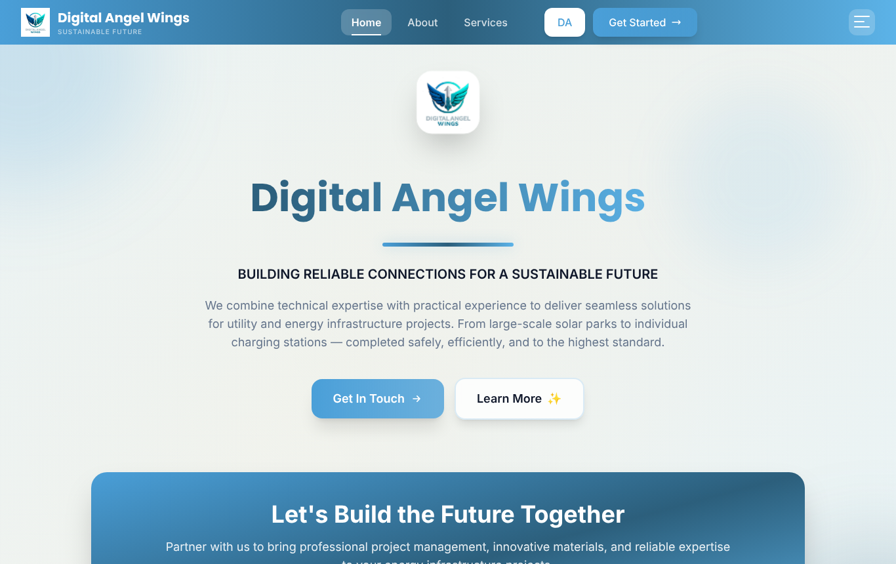

# Digital Angel Wings

A bilingual (English and Danish) website for Digital Angel Wings, a consultancy for energy infrastructure and sustainable development, with an admin panel for editing every page without touching code.



## Features

- **Public site:** home, about, leader's message, services, software products, work process, progress and contact pages
- **English and Danish:** switch language from the navigation bar; the choice is remembered
- **Contact form:** messages are saved and shown in the admin panel
- **Admin panel** at `/admin`: edit page text, team members, SDG goals and contact details; add, reorder, hide and delete services, software products and work-process steps; upload images; read and mark messages
- **Server-checked admin sign-in:** the password is checked by the API, which returns a signed session token that expires after 12 hours

## Tech stack

| Part | Built with |
| --- | --- |
| Front end | React 18, TypeScript, Vite, Tailwind CSS, Framer Motion, React Router, Axios |
| API | Node.js, Express, TypeScript, Multer |
| Database and images | Supabase (PostgreSQL and Storage) |
| Hosting | Vercel (`vercel.json` in each app) |

## Project structure

```
client/      React site and admin panel
server/      Express API (src/index.ts), admin auth (src/auth.ts)
supabase/    SQL migrations and seed data
```

## Run it locally

Requirements: Node.js 18 or later and a [Supabase](https://supabase.com) project.

**1. Database.** In the Supabase SQL editor, run these files from `supabase/` in this order:

1. `migrations/000_schema.sql`
2. `migrations/001_add_team_contacts.sql`
3. `seed.sql`
4. `migrations/add_danish_language_support.sql`
5. `migrations/001_create_services_table.sql`, then `002_seed_services_data.sql`
6. `migrations/002_storage_bucket.sql`
7. `migrations/003_add_services_metrics.sql`, `004_create_work_process_steps.sql`, `005_create_software_products.sql`, `006_seed_software_products.sql`

The `country_offices` table used by the API has no migration in this repository yet.

**2. API**

```bash
cd server
cp .env.example .env    # Supabase URL and key, ADMIN_PASSWORD, ADMIN_TOKEN_SECRET
npm install
npm run dev             # http://localhost:5000
```

**3. Site**

```bash
cd client
npm install
npm run dev             # http://localhost:3000, /api is forwarded to localhost:5000
```

## Tests

```bash
cd server
npm test
```

The tests cover the admin sign-in: password checks, token expiry and tampering, and which routes are public. GitHub Actions type-checks, tests and builds both apps on every push.

## Security

- The admin password lives only in the server's environment (`ADMIN_PASSWORD`). Every change, the admin lists, image uploads and the contact messages require the admin token; visitors can only read the site and send a contact message.
- The server can use `SUPABASE_SERVICE_ROLE_KEY`, which is never sent to the browser. With it, row-level security can be turned on for every table so the anon key can no longer change data.
- `.env` files are ignored by git.

## Contact

Email: dilwara4@yahoo.com
